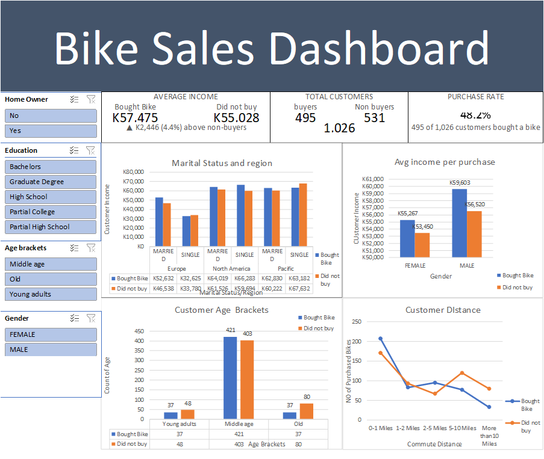

# Bike Sales Dashboard

An interactive Excel dashboard that turns raw bike sales data into clear, visual insights.

## Preview

## What this project shows
- Cleaned and structured raw sales data
- Pivot tables and charts summarizing sales
- Slicers for filtering by education/gender/age brackets
- and KPI summaries that update with the filters. 

## Tools used
Microsoft Excel (Pivot Tables, Charts, Slicers)

## Files
- `Bike_Sales_Dashboard.xlsx`: the full dashboard
- `images/`: screenshots

## Key insights
- Middle-aged customers make up the largest group, 824 of 1,026
- Shorter commutes go with more purchases. Among customers living 0-1 miles away, 207 bought and 171 didn’t, but beyond 10 miles only 33 bought and 80 didn’t.
